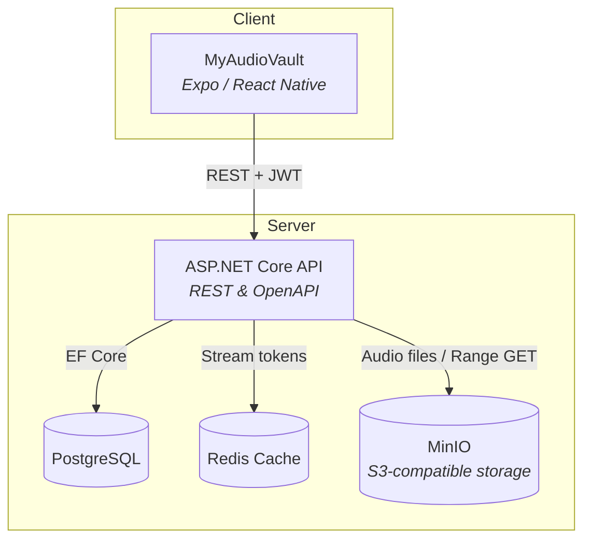

# Music Stream Core

Music Stream Core is a self-hosted music streaming platform for your own music collection. Upload your audio files to your own server and stream them from any device through the mobile app.

I built the full stack myself: the .NET backend (Clean Architecture, REST API, integrations with PostgreSQL, Redis, and MinIO) and the Expo/React Native client (strict TypeScript, generated API client).

## What problem does it solve?

Streaming your own music collection usually means relying on external cloud services or juggling loose files. Music Stream Core lets you host everything yourself: the backend stores your audio files and serves the streaming API, while the mobile app provides a smooth listening experience for your own collection. You keep full control of your music and your data.

## Features

- **Authentication & Authorization:** Secure user access with JWT access/refresh tokens and role-based authorization.
- **Song Upload & Storage:** Upload audio files (up to 20 MB) stored in MinIO, an S3-compatible object store.
- **Range-Request Streaming:** Token-based streaming endpoints with HTTP range support, so players can seek smoothly.
- **Song Library:** Paged, filterable song listing and per-song metadata retrieval.
- **User Management:** Users can edit their profile and password, while admins can manage any account.
- **Multi-Platform Client:** Expo/React Native app for Android, iOS, and Web, with login, signup, player, profile, and admin dashboard screens.

## Tech Stack

| Category      | Technology                                  |
| ------------- | ------------------------------------------- |
| Backend       | ASP.NET Core (.NET 10), C#                  |
| Architecture  | Clean Architecture, MediatR, FluentValidation |
| Database      | PostgreSQL 18, EF Core with migrations      |
| Cache         | Redis (StackExchange)                       |
| Object storage| MinIO via the AWS S3 SDK                    |
| Frontend      | React Native, Expo SDK 57, expo-router      |
| Language      | TypeScript (strict mode)                    |
| API contract  | OpenAPI, client generated with `@hey-api/openapi-ts` |
| State         | Zustand                                     |
| DevOps        | Docker Compose                              |

## Architecture

The system is a client-server setup. The .NET backend exposes a REST API, backed by PostgreSQL for metadata, MinIO for audio files, and Redis for distributed caching (stream tokens). The Expo mobile/web client generates its API client directly from the backend's OpenAPI spec.



### Backend (`backend/`)

- **Framework:** ASP.NET Core (.NET 10), organized as Clean Architecture (API → Application → Infrastructure → Core).
- **Patterns:** MediatR request/handlers with validators, EF Core with migrations.
- **Auth:** ASP.NET Identity with JWT access and refresh tokens.
- **Storage:** AWS S3 SDK pointed at MinIO; the configured bucket is created on startup, and an initial `admin` user is seeded.
- **Cache:** Redis (StackExchange) for short-lived streaming tokens.
- **API Docs:** Swagger / OpenAPI UI in the Development environment.

### Frontend (`MyAudioVault/`)

- **Framework:** Expo SDK 57 with expo-router file-based routing.
- **Language:** Strict TypeScript.
- **API Client:** Generated from the backend OpenAPI spec with `@hey-api/openapi-ts` — never hand-edited.
- **Auth:** JWT stored securely, with automatic access-token refresh.
- **State:** Zustand.

## Project Structure

```
music-stream-core/
├── backend/          # .NET 10 API (Clean Architecture) + Docker Compose for services
├── MyAudioVault/     # Expo / React Native client
├── docs/             # Architecture diagrams and backend configuration notes
└── scripts/          # Helper scripts for testing streaming and uploads
```

## Engineering Practices

- **Contract-first API:** the frontend client is generated from the backend's OpenAPI spec, keeping both sides in sync.
- **Integration tests:** the backend test suite runs against real PostgreSQL instances via Testcontainers — no mocked database.
- **Code quality:** strict TypeScript on the client; layered architecture with validators on the backend; EF Core migrations keep the schema versioned.

## Status

This is a personal learning project. It is under active development and is not intended for production use.
