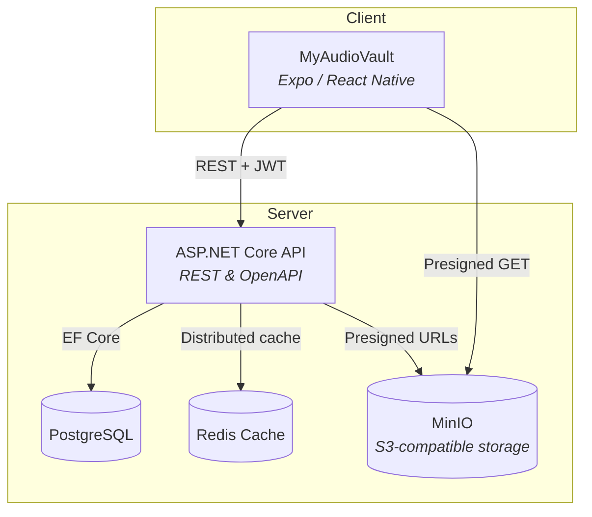

# Music Stream Core

> [!WARNING]
> **This project is under active development and is not yet MVP-ready.** It is not usable to an acceptable level at the moment: several essential features are still missing, and existing functionality may change or break between commits. Do not rely on it for a real music collection yet.

Music Stream Core is a self-hosted music streaming platform for your own music collection. Upload your audio files and cover art to your own server and stream them from any device through the mobile app.

I built the full stack myself: the .NET backend (Clean Architecture, REST API, integrations with PostgreSQL, Redis, and MinIO) and the Expo/React Native client (strict TypeScript, generated API client, custom playback experience).

## What problem does it solve?

Streaming your own music collection usually means relying on external cloud services or juggling loose files. Music Stream Core lets you host everything yourself: the backend stores your audio files and cover images, and issues short-lived presigned URLs so the app can stream directly from your object storage. You keep full control of your music and your data.

## Features

- **Authentication & Authorization:** Secure user access with JWT access/refresh tokens and role-based authorization.
- **Song Upload & Storage:** Upload audio files (up to 20 MB, MP3/WAV/OGG/M4A/FLAC) to MinIO, an S3-compatible object store. Uploads are validated by extension, MIME type, and audio signature, and song metadata is extracted automatically.
- **Cover Art:** Upload JPEG, PNG, or WebP cover images (up to 5 MB) per song; replacing an image removes the previous object from storage.
- **Presigned-URL Streaming:** The API issues short-lived presigned URLs, so the client reads and writes audio and images directly against MinIO. Seeking stays smooth because range requests are handled by the object store rather than proxied through the API.
- **Playback Experience:** Full player with seek bar, next/previous track, auto-advance, background playback, a persistent mini player, and a playlist queue.
- **Song Library:** Paged, searchable song listing with sorting and per-song metadata retrieval.
- **User Management:** Users can edit their profile and password, while admins can manage any account.
- **Multi-Platform Client:** Expo/React Native app for Android, iOS, and Web, with login, signup, player, playlist, profile, and a role-protected admin area.

## Tech Stack

| Category      | Technology                                  |
| ------------- | ------------------------------------------- |
| Backend       | ASP.NET Core (.NET 10), C#                  |
| Architecture  | Clean Architecture, MediatR, FluentValidation |
| Database      | PostgreSQL 18, EF Core with migrations      |
| Cache         | Redis (StackExchange) distributed cache     |
| Object storage| MinIO via the AWS S3 SDK, presigned URLs    |
| Frontend      | React Native, Expo SDK 57, expo-router, expo-audio |
| Language      | TypeScript (strict mode)                    |
| API contract  | OpenAPI, client generated with `@hey-api/openapi-ts` |
| State         | Zustand (playback queue and URL cache)      |
| DevOps        | Docker Compose                              |

## Architecture

The system is a client-server setup. The .NET backend exposes a REST API, backed by PostgreSQL for metadata and MinIO for audio files and cover images. The API returns short-lived presigned URLs so the Expo client transfers media directly to and from MinIO, while Redis is wired in as a distributed cache. The Expo mobile/web client generates its API client directly from the backend's OpenAPI spec.



### Backend (`backend/`)

- **Framework:** ASP.NET Core (.NET 10), organized as Clean Architecture (API → Application → Infrastructure → Core).
- **Patterns:** MediatR request/handlers with validators, EF Core with migrations applied at startup.
- **Auth:** ASP.NET Identity with JWT access and refresh tokens.
- **Storage:** AWS S3 SDK pointed at MinIO; the audio and image buckets are created on startup. Uploads are validated, metadata is extracted from audio files, and presigned URLs expire after 2 minutes for audio and 120 minutes for cover images.
- **Cache:** Redis (StackExchange) registered through `IDistributedCache`.
- **Seeding:** Startup creates the buckets and seeds an initial `admin` user if one does not exist.
- **API Docs:** OpenAPI document and Swagger UI in the Development environment.

### Frontend (`MyAudioVault/`)

- **Framework:** Expo SDK 57 with expo-router file-based routing.
- **Language:** Strict TypeScript.
- **Playback:** expo-audio with background playback, automatic track advance, playlist queue management, and a mini player shown across screens.
- **API Client:** Generated from the backend OpenAPI spec with `@hey-api/openapi-ts` — never hand-edited. Regenerate it with `npm run generate-api` while the Development API is running.
- **Auth:** JWT stored securely, with automatic access-token refresh.
- **Cover Art:** Loaded through cached presigned URLs, with a bundled default cover as fallback.
- **State:** Zustand for the playback queue and presigned URL cache.

## Project Structure

```
music-stream-core/
├── backend/          # .NET 10 API (Clean Architecture) + Docker Compose for PostgreSQL, MinIO, and Redis
├── MyAudioVault/     # Expo / React Native client
├── docs/             # Architecture diagrams and backend configuration notes
└── scripts/          # Helper scripts for testing uploads, presigned URLs, streaming, and deployment
```

## Engineering Practices

- **Contract-first API:** the frontend client is generated from the backend's OpenAPI spec, keeping both sides in sync.
- **Integration tests:** the backend test suite runs against real PostgreSQL instances via Testcontainers — no mocked database.
- **Storage offload:** media transfers go directly to MinIO through presigned URLs, keeping the API focused on metadata and authorization.
- **Code quality:** strict TypeScript on the client; layered architecture with validators on the backend; EF Core migrations keep the schema versioned.

## Status

This is a personal learning project. It is under active development and is not intended for production use.
